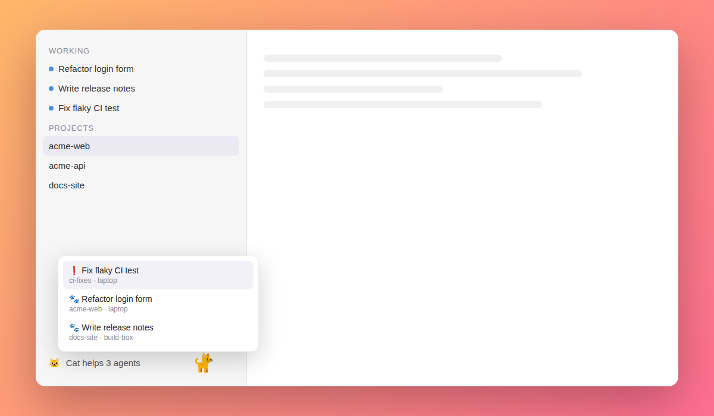

<p align="center"></p>

<h1 align="center">Pet</h1>

<p align="center">A cat in the <a href="https://paseo.sh">Paseo</a> sidebar that mirrors your agents.</p>



The cat sleeps when nothing runs, walks back and forth while agents work, and waves when one of them needs your permission. Its label counts the agents it is watching.

Click the cat to open the list of working agents. Each row shows the agent, its workspace and its host. Click a row to open that agent in its workspace, on any connected host.

The plugin runs in the app only. Every 3 seconds it reads the agent and workspace lists of each online host through the app's own connection and sends nothing anywhere else.

## Install

```bash
paseo plugin install github:puchkoff/paseo-pet
```

Requires Paseo 0.11.4 or later with plugins enabled (Settings → Plugins).

## License

MIT
